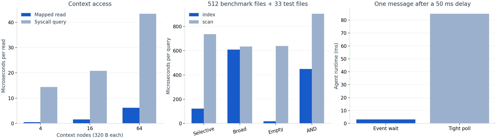

# 性能实验报告

客体时钟频率为 10,000,000 Hz。每组保留 11 个样本，下面使用中位数；P95 按最近秩计算（11 个样本时取最大值）。所有测量在单核 QEMU 的 RISC-V virt 客体中进行，不能当作实体硬件或宿主机性能。

## 一、复现与原始数据

先运行 `bash scripts/build.sh test`，再执行 `python3 scripts/run_benchmarks.py --root "$(cat artifacts/build/build-root.txt)" --output artifacts/benchmarks`。最后在安装 matplotlib 的宿主机执行 `python scripts/report_benchmarks.py`。

每次实验复制构建时的干净磁盘，先运行文件功能测试建立 33 个属性文件，再创建实验数据。不会把上一次 512 文件实验残留当作新的 32 文件数据集。

原始串口：`artifacts/benchmarks/serial.log`；356 条原始记录：`raw.json`；32 组统计：`summary.json`；构建输入与镜像 SHA256：`manifest.json`；工具版本：`versions.txt`。每组先比较结果，再测量；索引与扫描在所有分页上比较文件 ID 集合。

## 二、Context 直接读取与系统调用

两条路径返回相同数量、顺序和内容的 320 字节节点。每个样本重复 1,000 次，交替两种路径的先后顺序；计时区间不输出串口，每次真实消费读取结果，防止优化器消除访问。

| 节点数 | 直接读取 μs/次 | syscall μs/次 | 时间比 syscall/直接 |
| --- | ---: | ---: | ---: |
| 4 | 0.492 | 14.401 | 29.29 |
| 16 | 1.565 | 20.753 | 13.26 |
| 64 | 6.167 | 43.362 | 7.03 |

这里减少的是访问路径与用户缓冲区检查等开销。节点越多，数据复制所占比例上升，倍数随之下降。不能把该倍数直接解释成模型推理或完整调查的加速。

## 三、属性索引与全量扫描

目录共包含“实验文件数 + 33”个已登记文件；程序镜像没有登记属性。索引从最小候选集合开始做 AND 检查，扫描遍历全部目录。两者返回同样字段、每页最多四条；摘要缓存预热，不存在查询结果缓存，也未声称是冷缓存实验。

| 实验文件数 | 查询 | 索引 μs | 扫描 μs | 检查记录 索引/扫描 | 时间比 扫描/索引 |
| --- | --- | ---: | ---: | ---: | ---: |
| 32 | selective | 50.4 | 97.1 | 5/65 | 1.93 |
| 32 | broad | 102.9 | 126.6 | 32/65 | 1.23 |
| 32 | empty | 17.3 | 76.1 | 0/65 | 4.40 |
| 32 | and | 131.7 | 155.5 | 32/65 | 1.18 |
| 128 | selective | 103.5 | 263.8 | 8/161 | 2.55 |
| 128 | broad | 193.1 | 211.3 | 128/161 | 1.09 |
| 128 | empty | 18.0 | 179.7 | 0/161 | 9.98 |
| 128 | and | 184.0 | 261.1 | 80/161 | 1.42 |
| 512 | selective | 121.8 | 736.1 | 20/545 | 6.04 |
| 512 | broad | 609.6 | 635.0 | 512/545 | 1.04 |
| 512 | empty | 17.6 | 638.9 | 0/545 | 36.30 |
| 512 | and | 448.3 | 904.4 | 272/545 | 2.02 |

512 文件实验时，索引对象实际占用约 161.4 KiB；索引字符串有效内容 14.2 KiB。前者在单核临界区内按 buddy allocator 的实际分配增减统计，包含树节点与分配对齐，后者不包含这些开销。属性目录、摘要缓存和磁盘日志另计。

选择性高或无结果的条件减少了候选检查；宽泛条件仍处理大部分文件，收益很小，部分小样本可能更慢。索引还增加内存与更新维护成本。`index_update` 原始记录包含创建文件、写内容、设置三项属性和持久化的整批耗时，不能称为单纯内存索引更新耗时。

## 四、紧密轮询与事件等待

父进程收到子进程就绪通知后 sleep 50 ms，再发送同一条 IPC 消息。轮询基线持续调用 receive，不主动 yield；等待组使用 agent_wait。两组都通过两次内核进程查询取得运行 ticks 与调度次数，因此运行量包括共同的测量开销。

| 方式 | Agent 运行 ms | receive 次数 | wait 次数 | 调度次数 | 发送到收取 μs |
| --- | ---: | ---: | ---: | ---: | ---: |
| wait | 3.068 | 2 | 1 | 2 | 208.6 |
| poll | 84.872 | 6440 | 0 | 3 | 141.1 |

本次样本中等待组的 Agent 运行量比紧密轮询低 96.4%。唤醒涉及调度，延迟可能比已在运行的轮询更高。等待不保证系统整体 CPU 空闲：原有 initproc 和 shell 仍有轮询/yield 行为，报告只比较被测 Agent。

## 五、限制与真实模型待验收

QEMU 客体计时会受到宿主机负载、模拟器和缓存状态影响。样本数量有限，报告不作统计显著性或硬实时保证。内核、IPC 和页面指标均可独立复现；外部模型调用耗时、动态诊断正确性和完整端到端分解，仍需要用户提供可用 API 配置后另外测量。确定性回归耗时不得冒充真实模型耗时。
