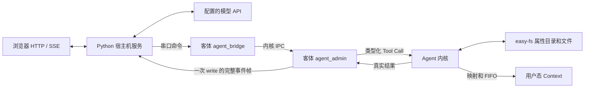
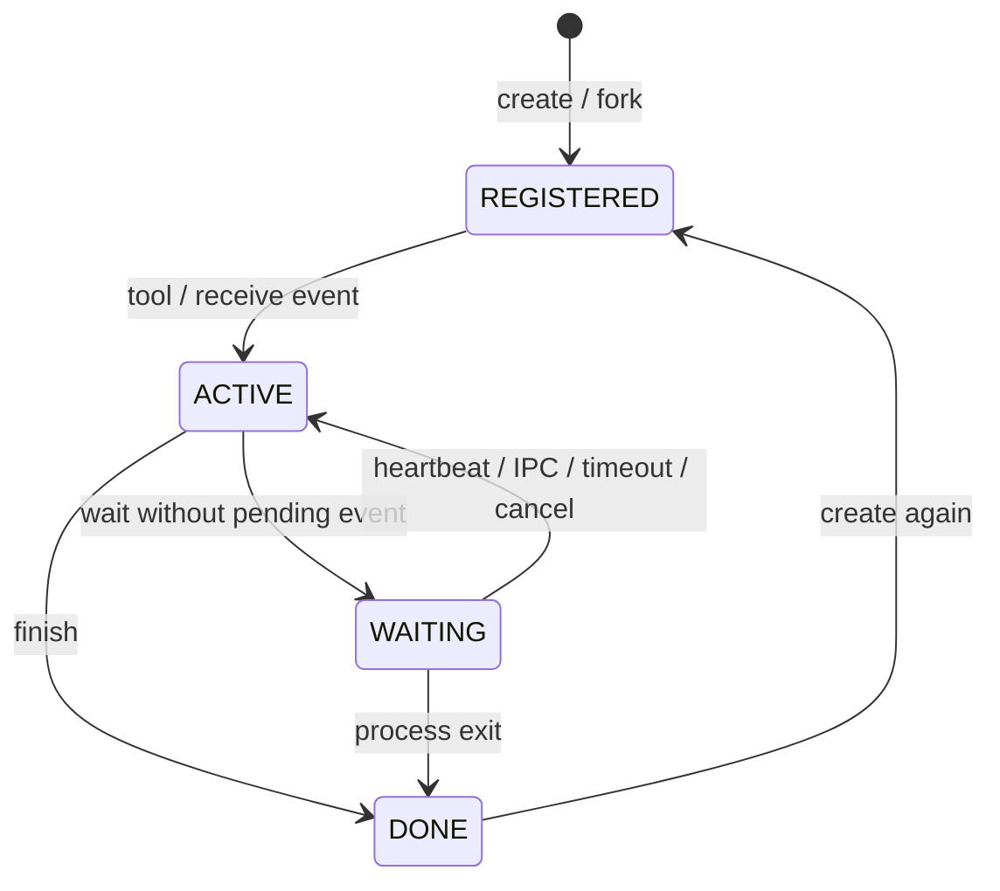

# AgentOS 实现设计

## 1. 与赛题和总体方案的对应关系

项目核心是在教学操作系统中建立 Agent 的身份、资源和调度语义。模型生成策略，客体进程执行策略，内核提供可信的工具结果与资源边界。将模型放在宿主机，是因为现有 no_std 客体没有通用 TLS/模型运行环境；这不会把工具执行搬到宿主机。

三个基础任务对应共享 ABI、PCB/虚拟内存和 Context 路径。进阶任务四由属性索引、摘要、缓存和持久化覆盖，任务五由心跳、事件、阻塞、IPC 和取消覆盖。任务六通过受控工作负载、实际内核观测、API 多轮调用和实时页面连接这些机制。用户暂未提供模型服务，因此模型质量和真实端到端验收单独保持待验证。

## 2. 数据流与职责

UART 输入只由桥接进程消费；Agent 输出都调用同一格式化函数，在一个 write 系统调用内写完帧。该单核内核不在用户系统调用中抢占执行另一个用户任务，因此帧不会被其他用户进程的半帧穿插。宿主机解码器仍接受启动日志、分片和损坏帧。Windows 管道按字节读避免等待满缓冲；输入按 128 字节小批发送，避免仿真 UART 的大突发丢字节。

Agent 在等待模型时执行 `agent_wait`，由调度器切换出去。宿主机收到模型请求后调用配置的 API，将决策通过桥接和 IPC 送回。Agent 校验来源 PID、实例与请求 ID，再执行一次工具、写 Context、发出下一轮请求。最大 16 次工具调用、最多 17 次模型请求；最后一轮仍可给出结论，要求继续调用则按预算终止并说明未完成。

## 3. Agent 身份、地址空间和生命周期

`AgentKernelState` 位于 PCB，保存 ABI 元信息、通信域、消息队列、订阅掩码和两个截止时间。Agent type 为角色标签，不作为权限凭据。IPC 权限依据父子继承的通信域与不可复用的实例号。

| 区域 | 地址/大小 | 用户权限 | 内容 |
| --- | --- | --- | --- |
| 控制页 | `0x40000000`，4096 B | 只读 | AgentInfo、环形元数据、代数、等待与消息计数 |
| 节点页 | `0x40001000` 起，按页取整 | 读写 | 320 B 的 ContextNode |
| 总映射 | 最大 65536 B | 分区权限 | 最多 192 个节点，包含控制页预算 |

每次映射先检查冲突并预留数据页和所需页表页，失败时释放临时资源；若第二段映射失败，先前控制页也撤销。释放 Context 时清理空页表分支。测试逐个注入物理分配失败，另行建立真实冲突页验证不覆盖已有映射。

fork 复制地址空间中的有效 Context，给子进程新的实例，清空心跳、等待和消息登记；父子节点页独立。exec 清除旧 Agent 状态，新程序需注册；退出释放所有映射和 IPC。finish 进入 DONE 并保留可查询的终止元信息，随后可以重新注册。Agent 拒绝额外用户线程，明确采用单写者/单等待者语义。

控制页写入时使用奇偶 generation：内核写前置奇，完成后置偶；用户直接读取前后检查同一偶数代数。用户不能改写控制页，但可以修改自己的节点内容。Context 不是防篡改审计存储，完整运行审计另存宿主机事件日志。

为容纳有界 ABI 和 JSON，用户栈及内核栈为 32 KiB，用户堆为 128 KiB；这些是程序基础开销，不计入 64 KiB Context 配额。每个消息最大 1536 B，最多四条排队，满队列返回 EAGAIN。

## 4. 工具 ABI 与可信边界

内核与用户库只从 `agent-abi` 引入结构定义。请求携带版本、请求 ID、工具名和最多六组带类型的 KV；参数支持整数与有界 UTF-8 文本。内核按工具注册表检查未知键、重复键、缺失必填项、类型、范围和尾部零字节。

所有新增指针接口在地址截断前校验 Sv39 低用户区、溢出、每一页的 U/R/W 权限和整个输出范围。错误缓冲区不会先写半个结果。结果是有界 JSON，而不是三个含义模糊的整数；过长结果显式返回容量错误。查询采用分页。

全局指标来自实际进程表、页分配器和客体时钟。进程运行 ticks 在每次调度切换累计，当前 Running 进程补计当前区间。两次快照之差才能表示窗口运行量；该值不是宿主机 CPU 指标。只读查询不改变被查询目标的状态。

十个工具及系统调用号详见《协议与接口》。文件工具只能操作现有平面文件，元数据保留文件不能通过普通 open 或属性工具覆盖。原有 rCore 接口并未全部改造成对恶意用户输入安全，因此安全结论限定于本项目新增接口和明确测试范围。

## 5. Context Path 的语义

每个节点记录请求 ID、工具名、参数摘要、结果摘要、返回状态、内核时间和单调序号。`tool_call_recorded` 对成功或错误工具调用都尝试追加一次。节点序号从 0 开始，回溯和清空后也不复用。

满配额时覆盖最早节点并增加 evictions。query 和直接映射读取都返回时间顺序下的最近窗口。rollback(keep) 保留当前窗口最早的 keep 个有效节点，后续追加从新边界开始；clear 清空有效长度和 head，保留累计淘汰数、序号和 generation。失效槽位不算有效历史。

为限制串口和模型输入，运行时事件最多展示最近八个节点；SDK 的 query 可以读取全部有效节点。完整的工具 JSON 保存在串口事件中，Context 内保留有界摘要，因此截断摘要不保证仍是完整 JSON，页面按文本展示。

## 6. 等待、心跳和 IPC

pending 检查与标记 Blocked 在同一禁中断 PCB 临界区完成，随后释放借用再调度，避免检查与等待之间丢失唤醒。唤醒仅对 Blocked 且未退出的任务入队，避免重复 Ready 队列项。

心跳和超时的截止时间直接存 PCB，在调度器边界检查；正常定时抢占为 100 Hz。心跳合并过期周期，不累计无限事件。修改或停止只修改当前 PCB 截止时间，不存在另一个持有旧任务引用的定时队列。该方案支持课程单核规模，不声称大规模定时器或硬实时最优。

IPC 由内核覆盖发送方身份，验证接收方 live、PID、instance 和 domain。实例防止 PID 重用后误投递；域限制独立 Agent 家族间发送。watch/unwatch 控制消息唤醒，取消和已启用心跳保留必要唤醒能力。取消不回滚已经完成的工具操作，停止的是后续推进；宿主机丢弃取消或旧运行对应的迟到模型结果。

## 7. 属性目录、索引和持久化

为现有文件分配稳定目录 ID，最多 1024 个文件，每文件最多八组属性；键 23 字节、值 63 字节。easy-fs 没有删除/重命名接口，当前名称到 ID 的映射在项目范围内稳定。未登记的程序镜像不会自动成为属性查询数据集。

目录使用 BTreeMap，倒排索引为 `(key,value) → 文件名集合`。AND 查询从最小集合开始筛选，再执行摘要关键词条件，按稳定 ID 分页。scan 模式遍历相同目录，作为正确性和性能基线。查询不缓存结果集合；摘要缓存按内容变更失效。

摘要来自文件开头最多 127 个 UTF-8 字节，是内容摘取，不伪装成模型语义摘要。普通 write、CREATE 覆盖和 TRUNC 会更新已登记文件版本并清空摘要缓存。属性修改也增加全局版本和文件版本，维护索引。

保留文件 `.agent-meta-a` / `.agent-meta-b` 保存 schema、epoch、稳定 ID、版本、记录长度和 FNV-1a 校验和。第一个完整记录为快照，后面追加单文件更新；每个日志最多 2 MiB。到达上限或检测到损坏尾后，在另一文件写完整新检查点，成功后切换；旧检查点保持可读取。加载时选有效 epoch 较大的文件，校验失败的尾部停止重放并上报。

校验和用于意外损坏检测，不是密码学认证。正常重启、损坏尾检测和后续检查点恢复经过四次 QEMU 启动验证；原有 easy-fs 的全盘断电一致性不在保证范围。磁盘分配改为失败返回并回收尚未提交的数据块，避免属性日志增长在空间耗尽时触发内核 unwrap；另有满盘单元测试验证原内容不变、无越界块和资源可再次使用。

索引内存报告分别给出字符串有效字节和索引对象的 buddy allocator 实际分配量。后者在更新索引的单核临界区中累计分配增减，不包含属性目录、摘要或磁盘缓存。

## 8. 服务、页面与运行证据

Python 服务绑定 127.0.0.1，检查 Host/Origin 与 JSON 大小，动作均来自固定白名单，没有任意 Shell 执行端点。API 密钥仅在本地配置/进程环境中，状态接口不返回 URL 和密钥；服务错误不转发可能含敏感信息的提供商响应体。

每次 QEMU 启动使用独立 UUID、磁盘副本和日志目录。串口命令 ID 单调递增，桥接保留最近八条、总计不超过 32 KiB 的请求/结果缓存：同 ID 同内容返回原结果，同 ID 不同内容拒绝，已淘汰旧 ID 不重复执行。

浏览器由 SSE 驱动，事件队列最多 1500 条，串口关联队列最多 2048 条。页面刷新取当前状态；落后于保留窗口时重新同步。完成任务内存保留最多 32 个，原始日志仍完整存盘。日志增长属于磁盘审计开销，服务不会自动删除用户已有记录。

真实、确定性和历史回放三种模式有明确标识。固定回归用四个步骤检查数据链路，没有通用诊断能力；回放读取已导出的状态，不能发送客体操作。真实模式的最终答复必须引用当前可用 Context seq；内核不执行模型文本中的任意代码，也不展示模型内部隐藏推理。

## 9. 验证结论的边界

详细要求、用例和证据见《验收矩阵》。性能原始数据、计时定义和不利样本见《性能实验报告》。本项目已经验证操作系统机制和测试模式闭环；真实模型动态决策、诊断质量和真实模型延迟必须在 API 配置后补充记录，不能由一次固定脚本或页面截图替代。
