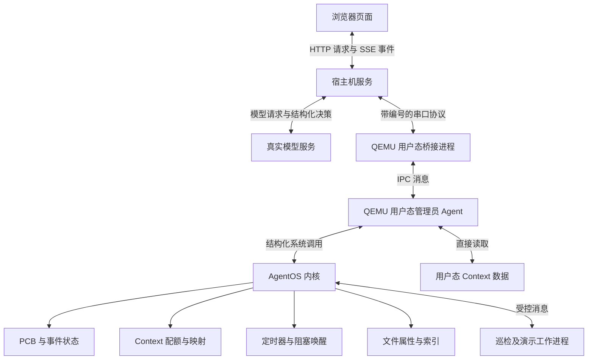
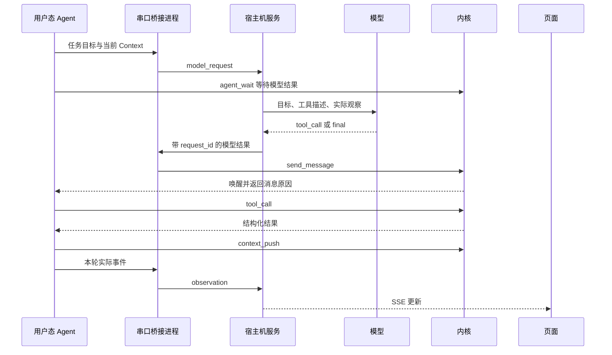
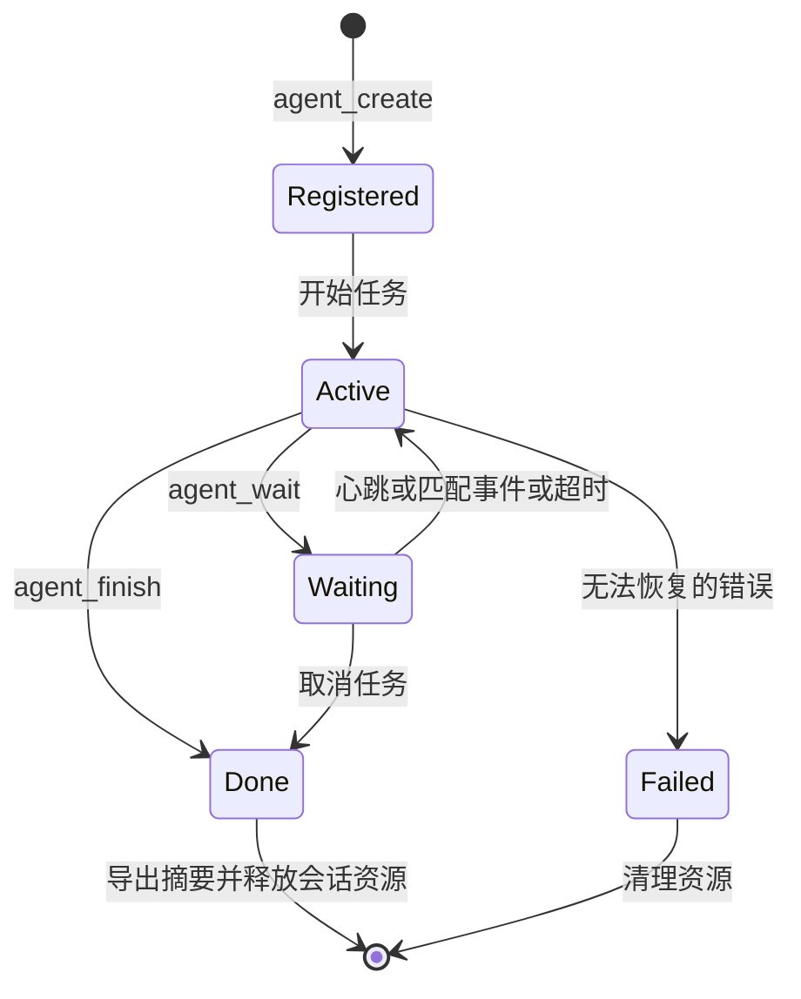

# AgentOS 项目总体方案

版本：方案 v1。用途：作为后续实现、联调、测试和结题材料的共同依据。本文中的新增功能均为建设目标，现状以第二部分的核对结果为准。推进顺序按依赖关系和验收结果确定，不按日期排期。

AgentOS 的最终目标是：在现有 rCore 教学操作系统上，让 Agent 成为内核能够识别、约束、唤醒和观察的一类进程；通过真实模型驱动的系统管理员场景，证明结构化工具调用、用户态上下文、事件调度和属性查询可以共同工作。

最终系统运行在 RISC-V 64 QEMU 中，模型服务和可视化服务运行在宿主机。模型提出下一步行动，QEMU 中的用户态 Agent 发起系统调用，内核执行并返回实际结果，下一轮模型决策再使用这些结果。项目需要同时交付源码、可复现运行入口、测试证据、性能实验和结题材料。

## 一 项目依据和完成范围

### 1 为什么采用这条主线

工作区的赛题说明把核心问题定义为“如果将 AI 智能体视为操作系统的一等公民，内核应该提供哪些原生支持”。其中直接强调了 PCB 扩展、Agent Context 区、结构化请求、上下文路径、资源配额，以及机制与策略分离。

已有项目已经使用 rCore，实现了 Agent 元数据、Context 映射、三个工具的原型和 FIFO 路径管理。此前对话又明确提出，演示应当连接真实 QEMU，展示动态模型决策，并围绕“帮我看看，系统为什么变慢了”形成可以讲清楚的场景。因此，沿用 rCore 并完成“Agent 系统管理员”是对现有需求和投入最直接的延续。

选择系统管理员场景还有一个实现上的理由：它会自然使用进程状态、时间统计、资源配额、文件查询、IPC 和等待唤醒。这些都是操作系统课程能够检查源码、解释机制并测量效果的内容。

### 2 最终版本承诺的范围

本方案把赛题任务一至任务六都纳入最终版本。其中任务四和任务五按赛题允许的选项做出明确选择，避免开发过程中不断改变范围。

| 赛题任务 | 最终版本目标 | 对应的项目价值 | 完成证据 |
| --- | --- | --- | --- |
| 任务一 Agent 进程与地址空间 | Agent 注册、PCB 元数据、独立 Context 映射、配额和完整生命周期 | 内核能够识别并管理 Agent | 创建测试、地址访问测试、普通进程共存测试、资源回收记录 |
| 任务二 结构化工具接口 | 工具名称和带类型的键值参数、结构化响应、工具描述、统一错误处理 | 模型行动能落到确定的内核接口 | 至少三个工具的真实调用及非法输入测试 |
| 任务三 上下文路径 | push、query、rollback、clear、直接读取、FIFO 淘汰 | 支撑连续多轮决策，并限制内存使用 | 五轮以上历史链、回绕和淘汰测试、直接读取对比 |
| 任务四 查询型文件扩展 | 文件属性、AND 查询、属性索引、短摘要匹配、结构化结果 | Agent 可以描述数据特征，而无需预先知道文件名 | 属性增删改查、索引一致性、重启恢复和索引对比实验 |
| 任务五 Agent Loop | 心跳、事件注册与等待、IPC 唤醒、完成与清理、多 Agent 共存 | Agent 无事可做时真正阻塞，有事时进入下一轮 | 状态转换、运行时间统计、事件竞态和多 Agent 测试 |
| 任务六 综合演示 | 真实模型巡检、QEMU 执行、实时页面、实验和完整文档 | 把独立机制组合成可解释、可复现的系统 | 现场演示、原始运行记录、性能数据、结题报告 |

真实模型和实时页面是本项目结合此前沟通增加的交付要求。赛题本身并未把特定模型品牌、聊天页面或云端部署列为基础任务。

最终版本不扩展到通用生产操作系统、完整 POSIX 权限体系、训练大模型、向量数据库或复杂分布式 Agent 平台。这些方向会引入大量与当前验收主线关系不大的工作。共享 Context、预测预取和动态加载工具保留为后续研究方向，不作为本次完成条件。

## 二 当前进展和已有工作的处理

### 1 以代码和日志判断现状

| 现有部分 | 已核对到的实际行为 | 判断和处理 |
| --- | --- | --- |
| rCore 底座 | 进程、页表、文件系统、定时器、阻塞队列、UART 等基础设施已经存在 | 保留，围绕现有机制扩展 |
| Agent PCB | `ProcessControlBlockInner` 包含 Agent 状态，已有类型、周期、配额和路径字段 | 保留并补充运行事件、资源清理和明确状态语义 |
| Context 映射 | 注册时在 `0x4000_0000` 映射 16 页用户可读写区域 | 保留分层思想，补充地址冲突检查、按配额分配和失败处理 |
| 工具调用 | 请求为 `tool_id + arg0 + arg1`，响应为三个数值和状态码 | 已有分发原型；升级为满足工具名称、键值参数和结果类型要求的协议 |
| 系统状态工具 | 当前返回的是调用进程的线程槽统计、文件描述符表长度和 Context 长度 | 修改成有清晰口径的系统与进程观测；不能把现有值当作 CPU 或全局内存统计 |
| Context 路径 | 已实现追加、查询、FIFO、截断和清空 | 保留算法，补齐结构化摘要、直接读取方式与边界测试 |
| 心跳 | `heartbeat_set` 只修改 PCB 中的周期数值 | 需要实现定时触发、阻塞、唤醒和取消 |
| 现有测试 | `agent_admin` 按固定流程调用工具，`agent_probe` 检查未知工具 | 保留为回归测试的来源，另外增加真实模型 Agent |
| 历史运行日志 | 保存了原型工具调用和 Context 流程的串口输出 | 作为历史基线；不能替代最终代码在当前环境下的验收 |
| 仪表盘 | `dashboard/app.js` 用本地数组推进状态，没有真实 QEMU 数据连接 | 重做数据连接和状态来源；可保留有用的布局与配色 |
| 文档 | 已说明原型边界，但运行路径和验证环境属于旧环境 | 后续随实际实现更新安装、协议、测试和演示说明 |
| 演示材料 | 已有开题 PPT 和多轮修改材料 | 保留开题定位；结题材料根据最终结果重新组织 |

目前最准确的进度描述是：**已有可以继续扩展的内核原型，基础任务存在实际代码，但还没有完成真实模型、内核等待唤醒、属性查询和实时展示组成的综合系统。** 不适合用一个缺乏依据的完成百分比概括。

### 2 保留和修改的原则

保留 rCore、已有 Agent 入口、Context 环形结构和有用的原型测试。优先修正接口语义、运行机制和错误路径，再完善可视化表现。

原型的确定性调用流程仍然适合回归测试，不能因为它不是模型自主决策就全部删除。旧页面如果保留，必须清楚标为原理模拟或历史演示；最终验收入口只展示本次实际运行数据。

修改前保存可复现的基线，包括源码版本、构建记录、原始串口输出和旧材料。仓库中已有修改不能通过整体重置抹去。旧文档或旧页面在替代版本验证后再归档。

## 三 最终使用体验和系统架构

### 1 用户看到的完整流程

用户启动项目后，页面显示 QEMU 连接状态、当前运行标识、Agent 列表和实际系统指标。用户输入“检查系统为什么变慢，并给出证据”。系统随后发生以下过程：

1. 管理员 Agent 接收任务并获取当前工具描述。
2. 模型根据任务选择工具及参数。
3. 用户态 Agent 校验决策格式，调用内核工具。
4. 内核执行真实查询，返回有状态码、字段含义和时间戳的结果。
5. Agent 将本轮请求和结果写入 Context Path。
6. 模型读取实际观察结果，决定继续查进程、查诊断文件、发送消息或结束。
7. 页面逐条展示工具调用、系统状态、Context 更新和事件原因。
8. Agent 输出结论并引用对应的调用或 Context 序号；结束后释放本次会话资源，或进入下一次巡检的等待状态。

注入受控 CPU 工作负载后，应当能够观察到统计变化，模型据此指出相关进程。普通状态、忙碌状态和信息不足状态下，结论应当与证据相符。

### 2 分层架构



### 3 各层职责及理由

| 层次 | 负责的事情 | 这样划分的理由 |
| --- | --- | --- |
| 内核 | 身份和资源元数据、工具校验与执行、地址边界、配额、阻塞与唤醒、文件索引 | 对应赛题要求，且这些机制必须由可信层约束 |
| QEMU 用户态 Agent | 持有任务状态、调用工具、整理 Context、控制轮次、处理结束 | 保留真正运行在操作系统里的 Agent 进程，策略数据放在用户态 |
| QEMU 用户态桥接进程 | 串口收发、协议解析、请求分派、把模型结果作为消息投递 | 隔离宿主机通信与 Agent 主循环，复用 UART 的阻塞读取 |
| 宿主机服务 | 启动和连接 QEMU、调用模型、维护连接状态、推送观察事件 | 使用宿主机成熟的网络和模型运行能力，减少教学内核外围负担 |
| 模型 | 根据目标和实际观察选择下一步动作，给出证据支持的结论 | 实现需求中的动态决策 |
| 浏览器 | 展示真实事件和提交用户操作 | 让运行过程容易检查和解释 |

模型调用采用“模型输出结构化工具调用，应用执行并回传结果”的方式。模型服务官方文档也以这一往返过程描述客户端工具调用；这里的应用执行部分进一步落到 QEMU 用户态与内核接口中。[模型工具调用说明](https://platform.claude.com/docs/en/agents-and-tools/tool-use/overview)

模型推理在宿主机，并不意味着 AgentOS 的核心功能在宿主机。是否满足内核项目要求，取决于 Agent 身份、结构化接口、Context 管理、阻塞唤醒和查询机制是否确实由 QEMU 内核实现，以及能否独立测试这些机制。

### 4 一轮决策如何穿过整个系统



等待模型期间，Agent 应当阻塞；桥接进程等待串口输入时也应复用阻塞读取。心跳到达时可以标记“需要后续巡检”，但同一个 Agent 不能因为多个心跳而并发开启重复模型请求。

## 四 Agent 身份和地址空间方案

### 1 创建语义

保留现有“普通进程调用 `agent_create`，注册为 Agent”的实现路线。用户库另外提供组合辅助函数，完成 `fork/exec` 后的 Agent 启动。这样既对应现有代码，又让创建过程清楚可测。

创建参数至少包含协议版本、Agent 类型、Context 配额和初始心跳设置。重复注册返回明确错误；非法类型、零容量和超出上限的请求必须有文档规定的行为。对超限配额优先返回错误并给出允许范围，避免静默截断导致用户误解实际资源。

### 2 内核保存什么

PCB 或其关联的 Agent 状态保存：类型、实例标识、Context 基址与容量、有效节点数、写位置、下一序号、淘汰计数、Loop 状态、心跳配置与下次触发点、订阅事件、待处理事件以及有界收件箱。

跨进程消息和工具权限采用明确的能力范围。Agent 类型名称只用于分类，不自动授予管理员权限。初始启动程序为演示进程建立允许的通信关系，子进程只继承允许范围，调用者不能凭注册参数自行扩大权限。

这些字段由内核维护。用户即使修改自己的 Context 内容，也不能改变配额、他人消息队列或工具权限。

### 3 用户态保存什么

Context 数据区保存请求摘要、结果摘要、时间戳、调用序号、结果类型和有界数据。完整模型对话可以保存在宿主机的本次运行记录中；内核无需为长篇自然语言分配无限内存。

Context 区使用按页对齐的固定保留窗口，首先检查它不与现有地址空间冲突，再根据实际配额映射所需页面。现有 `0x4000_0000` 可继续作为候选位置，但不能假设所有程序都一定不占用此区域。

建议把只读控制页和可读写节点区分开：控制页向用户提供可信的容量、长度、位置和版本快照，节点区保留用户态数据的访问效率。内核始终使用 PCB 元数据做校验。控制页是否采用独立页面，以及默认容量大小，在 ABI 实现前通过内存预算固定下来；初始预算以每 Agent 不超过现有 64 KiB Context 上限为基准。

分配失败时返回资源错误，并回收已经分配的页。既要计算 Context 数据页，也要考虑新增页表和关联结构的分配；不能只做一次空闲页预检查就声称分配路径安全。

### 4 fork 和 exec 的规则

`fork` 保留独立地址空间拷贝，子进程可继承 Context 历史快照，但必须取得新的 Agent 实例标识。挂起的模型请求、消息、等待队列登记和事件订阅不继承；心跳在子进程显式启用后才开始。这样可以避免父子进程错误消费同一份异步结果。

`exec` 清理旧 Agent 状态和所有等待登记，再替换地址空间。进程退出同样必须取消心跳、移除订阅、丢弃收件箱并回收 Context。旧定时器或旧模型响应不得作用到复用 PID 的新进程。

### 5 验收重点

检查正常创建、重复创建、非法参数、映射冲突、分配失败、普通进程共存、跨 Agent 隔离、fork 独立性、exec 清理和反复退出后的资源回收。这里的隔离证明针对本项目新增接口和 Context 映射，不据此宣称整个教学操作系统已经具有生产级安全保证。

## 五 结构化工具接口方案

### 1 采用两层协议

宿主机和模型之间使用 JSON，便于模型理解和前端展示。用户态和内核之间使用有版本、长度上限和明确字段类型的二进制 ABI，避免在内核中处理任意深度的 JSON。

二进制 ABI 同样必须包含工具名称和键值参数。赛题明确允许自定义二进制格式，因此重点是信息完整、可解析、可扩展和错误行为明确。

对外请求示例只表示目标格式：

```json
{
  "version": 1,
  "request_id": 42,
  "tool": "query_process",
  "params": {"type": "agent", "status": "ready", "limit": 16}
}
```

对应响应包含 `request_id`、`status`、`result_type`、结果记录、采样时间和必要的分页信息。发生错误时返回错误码、失败字段和可读说明。示例中的编号不代表实际运行数据。

### 2 ABI 的约束

内核与用户库共用一个 `no_std` 协议模块，统一结构体、常量、版本和错误码。对字符串、参数个数、记录数、消息长度和总响应长度设置上限。参数使用整数、布尔、字符串等明确类型，不把所有输入都塞进无语义的整数槽。

接口使用固定宽度字段，规定字节序和长度含义。不要直接传递含有堆指针的 `String`、`Vec` 或未规定布局的 Rust 类型。跨边界数据必须完整初始化，避免把填充字节作为结果泄露。只允许对可验证的线格式进行反序列化，不能把任意用户字节直接解释成有非法取值的语言类型。

用户指针检查包括地址规范性、整数溢出、所有涉及页面、用户权限和读写权限。带副作用的工具应先完成必要的输入和输出缓冲区校验，再执行操作，减少执行成功却无法返回结果的情况。可变长结果规定容量不足和分页行为。

### 3 工具集

| 工具 | 输入和实际输出 | 主要用途 |
| --- | --- | --- |
| `get_system_status` | 返回进程数量、Agent 数量、物理页统计、可运行任务数和采样窗口信息 | 巡检入口，建立全局观察 |
| `query_process` | 按 PID、类型和状态筛选；返回实例标识、状态、运行统计、内存映射统计 | 定位工作负载和阻塞进程 |
| `read_context` | 返回自身 Context 元数据或指定范围的节点 | 历史引用、路径解释和验收 |
| `query_file` | 接受属性 AND 条件、摘要关键词和分页参数 | 查找与诊断对象有关的文件 |
| `set_file_attr` | 为允许范围内的文件设置属性 | 准备或更新可查询数据 |
| `delete_file_attr` | 删除指定属性并更新索引 | 验证索引维护 |
| `send_message` | 目标实例标识、消息类型和有界负载 | Agent 协作、结果投递和受控演示控制 |

工具注册表提供名称、描述、参数类型、必填项、上限和所需能力。宿主机根据注册表生成模型工具描述，避免前端、模型和内核各维护一份不一致的工具定义。

### 4 系统指标的口径

运行时间优先由调度进入和退出时的时间累计得到；如果实现选择定时采样，应明确标注为估计值。CPU 指标表示本次 QEMU 客体中指定窗口的运行占比，不能与宿主机 CPU 占用混为一谈。

进程内存指标标明统计的是映射页、驻留数据页还是包含页表的总分配页。文件描述符的活动数量与描述符数组长度也应区分。指标定义写入协议说明，页面使用相同名称和单位。

### 5 错误和安全边界

至少覆盖未知工具、未知参数、缺失参数、参数类型不符、字符串过长、响应空间不足、无效指针、目标不存在、目标已退出、权限不足和资源不足。

消息目标使用 PID 与实例代数组合，减少 PID 复用导致的误投递。对于控制演示工作负载，只允许向本次演示创建的工作进程发送约定消息，不提供可以任意执行宿主机 Shell 的模型工具。

## 六 Context Path 方案

### 1 节点和写入语义

一个节点对应一次实际工具尝试，包含调用序号、工具名称、请求摘要、返回状态、结果摘要、客体时间戳和关联请求编号。工具返回错误也需要记录，使模型能够基于失败调整下一步。

本版本由用户态 SDK 在工具调用后统一调用 `context_push`，保证每次调用只记录一次。内核提供序号和时间戳，校验写入位置并维护环形元数据。测试程序仍然可以直接使用 push 接口验证边界行为。

用户态节点可能被所属进程修改，因此不能用它作为权限或资源计费的唯一依据。展示和模型使用它作为工作记忆；关键错误码、调度计数和配额仍由内核状态决定。

### 2 容量和淘汰

采用 FIFO 环形缓冲区，延续现有实现。近期工具结果最常参与下一轮判断，而 FIFO 的更新成本固定，容易验证内存上限。

同时公布字节配额、可容纳节点数、当前长度、写入位置、累计淘汰数和最早有效序号。实际容量由映射大小和节点大小计算，不能把“4 个节点”和“64 KiB”当作同一单位使用。

演示可以使用 4 或 8 个节点制造回绕；正式默认容量根据节点大小确定。连续写入后占用应稳定在配置范围内。

### 3 直接读取

SDK 根据控制页的长度和环形位置按时间顺序读取节点，不能把物理槽 0 当作最新或最早节点。使用版本号或等效快照规则识别更新中的元数据。初版规定每个 Agent 只有一个 Context 写入者，后续若支持多线程写入，再增加对应同步设计。

一次已有映射内的快照读取不应为每个节点发起系统调用。查询系统调用仍保留，用于兼容、校验和实验比较。

### 4 rollback 和 clear

保留现有“保留当前有效窗口的前 k 个节点”的回溯定义，并提供根据序号定位的用户库辅助方法。被 FIFO 淘汰的历史不能恢复。回溯会改变后续决策所使用的路径，不撤销已经发送的消息或修改过的文件。

清空路径把有效长度归零并更新路径代数；序号保持会话内可区分。累计统计是否重置必须在接口里明确，建议另设本次路径计数与累计计数，避免演示时数字突然失去含义。

### 5 关键验收

覆盖空路径、恰好装满、多次回绕、五轮以上工具调用、错误节点、回溯到零、回溯后追加、已淘汰序号、清空后重用、直接读取与系统调用读取一致，以及长期写入内存不增长。

## 七 Agent Loop 和多 Agent 运行方案

### 1 区分三类状态

任务的调度状态沿用 rCore 的 Ready、Running、Blocked 等定义；Agent Loop 状态描述任务是否已开始、等待什么、是否完成；页面还会展示模型请求中、工具执行中等会话阶段。这三类状态不能用一个 `ACTIVE` 字样代替。

建议 Loop 状态为已注册、活动、等待、完成和错误终止。等待原因另设字段，区分心跳、IPC、模型结果和超时。模型在宿主机思考时，页面可以显示“等待模型”，同时显示客体任务为 Blocked。



### 2 心跳机制

新增或完善 heartbeat_set、heartbeat_stop 和 wait。设置心跳时记录下一次截止时间；定时器检查到期后产生心跳事件，只有处于对应等待中的 Agent 才被放回就绪队列。

动态改周期应使旧定时登记失效。停止后不得继续因旧截止时间唤醒。多个周期在一次长操作中错过时合并为一个待处理心跳，并记录必要的合并计数，避免积压无限事件。

现有定时器频率为每秒 100 次，基础检查粒度约为 10 ms。因此最小心跳间隔与唤醒误差应以实际定时器能力定义，不承诺毫秒级精确调度。最终测试报告实测误差和运行配置。

### 3 事件等待和 IPC

首个必须完成的事件源是 IPC 消息，它直接服务于模型结果投递和多 Agent 协作。提供 watch、unwatch 和 wait，订阅可以包含消息类别及允许的来源。文件修改事件可在文件扩展接入后增加，但 IPC 与心跳已经构成明确的两类触发。

`agent_wait` 先检查是否存在待处理事件，有则立即返回；没有则原子地登记等待并转入 Blocked。超时、消息到达和心跳必须共用能识别本轮等待的代数，确保同一任务只入队一次。

收件箱设定消息条数和总字节上限。队列满时返回明确错误，发送方可以根据工具结果调整，不允许无界分配。初版使用消息复制，不实现共享可写 Context，这样更容易证明进程隔离。

### 4 必须处理的竞态

| 情况 | 期望行为 |
| --- | --- |
| 消息恰好在进入等待前到达 | wait 直接消费待处理事件，不发生丢失唤醒 |
| 心跳和 IPC 同时到达 | 合并或按规则返回，任务只入就绪队列一次 |
| 等待已被消息唤醒，旧超时随后到达 | 识别过期登记并忽略 |
| Agent 等待中退出或 exec | 取消登记，旧事件不能访问已释放状态 |
| PID 被新进程复用 | 旧实例的消息和模型结果被拒绝 |
| 多次取消或重复到达的响应 | 幂等处理，避免重复执行有副作用的动作 |
| 等待中改变心跳周期 | 新周期生效，旧周期不再触发 |

现有 `wakeup_task` 会直接把任务设为 Ready 并入队，因此不能简单地让多个事件源都无条件调用它。需要由等待状态和代数判断是否还有一次有效唤醒，再进行入队。

### 5 完成和取消

`agent_finish` 表示本次 Loop 已完成，取消心跳和订阅，停止接收本次会话的模型结果。需要保留的结论先导出为运行记录或诊断文件，再释放 Context 和队列。进程随后可以退出，或回到普通服务状态；两种行为由用户库入口明确区分。

取消操作经同一条消息和状态路径处理。不能只停止网页动画而让客体继续执行。

### 6 多 Agent 调度

沿用 rCore 当前的就绪队列和抢占机制，先证明多个 Agent 在可运行时都获得执行机会。公平性不等于固定平均时间片，测试应明确任务负载、阻塞行为和统计窗口。

综合场景至少包括管理员 Agent、周期巡检或报告 Agent，以及受控工作进程。它们通过独立 Context 和有界 IPC 交互。初版不新增复杂优先级策略，避免把验证范围扩大到全新的调度器。

“Agent 等待时不消耗 CPU”的证据应是该任务处于 Blocked，且其运行时间或调度次数不继续增长。QEMU 进程的宿主机 CPU 占用还受到教学内核其他任务与设备模拟影响，不能据此要求宿主机占用为零。

## 八 面向 Agent 的文件查询方案

### 1 数据模型

在现有 easy-fs 上增加与文件身份关联的属性目录，支持 type、owner、tag 等有界键值属性。保留现有文件内容读写接口。当前教学文件系统的目录能力有限，方案按其现有文件命名空间实现，不预先假设完整层级目录和通用扩展属性已经存在。

文件身份优先使用稳定 inode 标识或受控文件标识，并建立名称映射。属性删除是本次范围的一部分；一般文件删除是否存在由 easy-fs 现有接口决定，不把“删除属性”误写成实现完整文件删除语义。

元数据通过内核管理的保留文件持久化，记录格式包含版本、长度、序号和完整性校验。普通应用不能直接覆盖这个保留文件。启动时读取有效记录并重建索引。初版保证正常关闭和重启后的恢复，异常尾记录应被识别；不声称现有 easy-fs 因此具备完整掉电事务能力。

### 2 索引和查询

使用 `(属性名, 属性值) -> 文件标识集合` 的内存索引。Rust 的有序映射和集合适合当前小规模教学系统，便于实现和解释。

多个属性条件执行集合交集，并优先从候选较少的条件开始。然后检查摘要关键词等附加条件，最后返回文件标识、名称、命中属性、摘要、版本和分页信息。

属性更新时同时维护目录和索引。文件内容变化时更新摘要或标记失效；旧缓存通过版本识别，不能返回已过期的内容却继续宣称有效。

### 3 摘要和缓存

摘要采用前一段有界文本或显式关键词，初始上限可采用赛题举例的 128 字节。匹配规则明确为子串或关键词匹配，处理 UTF-8 截断边界；不把这种方式称为向量语义检索。

查询结果以结构化形式返回，用户态可写入 Context 作为短期缓存。缓存记录查询条件和文件版本，用户态决定何时复用，内核负责资源上限。模型长篇总结仍留在用户态或宿主机。

### 4 为什么文件查询属于本项目主线

管理员发现某个进程异常后，可以按 `type=diagnostic AND owner=对应对象` 查找诊断文件，无需在提示词里写死文件名。该动作同时连接进程观测、属性检索和 Context 历史，使任务四真正参与综合场景。

### 5 验收和性能条件

检查设置、覆盖、删除属性，多条件交集，无结果，分页，摘要变化，缓存失效和正常重启恢复。索引查询与全量扫描必须返回相同结果。

性能实验使用相同数据集、相同查询条件和相同返回字段，在多个数据规模和选择率下比较。报告扫描记录数、候选数量、索引内存和客体耗时。索引需要在有代表性的选择性查询中展示实际收益；小数据集或宽泛查询没有优势时如实说明，不预设“所有查询都更快”。

## 九 真实模型与宿主机桥接方案

### 1 模型接入方式

提供可替换的模型适配器，配置服务地址、模型名、认证方式和超时。优先接入一个经过实测、能稳定输出工具调用的真实模型，再根据运行条件增加本地模型适配。

模型品牌和规格在接入时根据实际可用服务及机器条件确定，不在本方案中假定已有 API 额度或足够运行本地模型的硬件。最终验收必须保存一次可追溯的真实模型闭环记录。若只完成接口或使用规则驱动测试，真实模型这一项仍不能标为完成。

API 密钥只放在宿主机配置或环境中，不进入内核镜像、浏览器脚本、源码仓库和演示截图。模型请求只包含本次演示需要的客体数据。

### 2 Agent 如何作出动态决策

给模型的输入包含用户目标、可用工具描述、当前轮次、Context 历史和最新观察。输出允许两种形式：工具调用，或包含证据引用的最终答复。每一轮可以选择不同工具和参数。

提示词负责规定“根据观察决策、缺少证据时继续查询、不要把假设说成事实”。执行层仍要独立检查工具名、参数和能力范围，不能只依赖提示词。

初版每次只执行一个工具调用，使调用顺序、Context 序号和错误恢复容易检查。设置每次任务最大轮数、单次模型超时和总调用上限；这些是可配置运行约束，不是固定工具流程。达到上限时返回已经取得的证据和未解决问题。

前端展示模型提供的简短行动说明、工具参数、观察结果和最终结论。可验证的调用轨迹就是本项目需要的“决策过程”，不以展示模型内部隐藏推理为验收条件。

### 3 桥接协议

优先采用 QEMU 串口，因为现有内核已经有 UART 和阻塞读支持。宿主机独占连接，客体由一个桥接进程统一收发，避免多个进程竞争消费串口输入。

帧带有协议标识、版本、运行标识、请求编号、类型和长度限制。可使用带明确前缀的 JSON 行，但必须处理半帧、多帧、UTF-8、超长输入、启动日志混入和断线。输出应由单一发送路径串行化，不能让其他进程的打印穿插破坏协议帧。

主要消息类型为启动握手、提交任务、模型请求、模型结果、实际观察、取消、状态快照和错误。QEMU 每次重启生成新的运行标识，旧响应直接丢弃。

对有副作用的请求不进行无条件自动重试。利用请求编号和有限的结果记录识别重复；在无法判断操作是否已执行时返回不确定状态，再通过查询核对。

### 4 宿主机服务

建议使用 Python 提供进程管理、串口协议、模型适配、运行记录和 HTTP 服务，尽量保持依赖简单。前端沿用 HTML、CSS 和 JavaScript，初版无需为页面额外引入大型框架。

浏览器命令使用 HTTP，实时事件使用 SSE。服务提供当前快照和事件游标，使刷新或短暂断线后能够恢复显示；超过事件保留范围时获取新快照。原始串口日志与结构化事件分别保存。

本地服务绑定回环地址，只提供明确列出的项目动作。检查请求来源和输入长度，避免本地网页接口意外成为任意命令执行入口。启动命令由服务内部固定，不让模型或浏览器传入任意 Shell 文本。

### 5 正常模式和验证模式

真实模型模式用于综合验收。确定性模式用固定输入检查协议、内核结果和 UI 是否一致，适合自动回归。历史回放用于离线讲解已有记录。

三种模式必须明确标识。真实模型失败时显示失败原因和已有结果，不能自动切换成脚本后继续显示“模型正在决策”。离线测试模式可以继续验证系统机制，但不替代真实模型验收。

## 十 实时可视化方案

### 1 页面区域

| 区域 | 内容 | 数据来源 |
| --- | --- | --- |
| 运行总览 | QEMU 连接、运行标识、模型模式、最近更新时间、错误状态 | 宿主机连接状态和客体握手 |
| 任务输入 | 目标、开始、取消、演示场景控制 | 用户操作及客体确认 |
| 系统和进程 | 全局指标、Agent 列表、状态和运行统计 | 内核查询结果 |
| 决策与调用 | 模型选择的工具、参数、返回值、耗时和错误 | 模型响应及实际工具结果 |
| Context 路径 | 时间顺序、环形槽位、容量、淘汰和回溯 | 客体 Context 快照与事件 |
| 等待与唤醒 | 状态变化、等待原因、心跳和 IPC | 内核事件观测 |
| 文件查询 | 条件、命中文件、摘要和索引统计 | 文件工具结果 |
| 结论与记录 | 结论、证据引用、导出日志、实验结果入口 | 本次运行记录 |

### 2 展示规则

页面不自己计算虚构的进程数或循环轮次。连接中断后保留最后一份数据并标明已过期；重连后根据新运行标识重建状态。

工具选择、内核完成和 Context 写入分别显示，便于定位是哪一层出错。CPU 统计标明窗口，客体时间与宿主机模型耗时分开，避免把网络延迟解释成内核调用慢。

Context 同时提供“逻辑时间顺序”和“物理环形槽位”视图，便于解释 FIFO。地址空间示意和状态图可以作为说明性图形，但标清哪些值是实际采样，哪些是固定结构说明。

视觉风格延续此前认可的简洁蓝白方向，保证投影可读和主要证据易找。界面细节在真实数据链路稳定后完善。

### 3 如何验证页面确实接入了系统

启动或结束一个实际工作进程，进程列表应变化；修改真实 Context 配额或推进调用，环形状态应变化；停止 QEMU，页面应显示断开；重启 QEMU，旧运行数据不能混入新运行。至少这些操作通过后，页面才能标为实时可视化完成。

## 十一 综合演示场景

### 1 主场景 系统管理员诊断

先展示普通状态，再启动一个受控 CPU 工作进程。用户提交相同诊断目标，模型先获取全局信息，再根据结果查询具体进程，必要时检索带有该对象属性的诊断文件，最后引用实际采样给出结论。

工作负载的强度、持续条件和退出方式由演示程序控制。CPU 工作进程分段执行计算，并能够接收停止消息；不能为了制造异常而让系统进入无法清理的状态。

如果提供处置步骤，限定为向本次演示工作进程发送停止或恢复消息，并再次查询验证变化。最终报告区分“发现相关性”“定位受控负载”和“经处置后验证改善”，不把一次采样包装成普遍故障诊断能力。

### 2 辅场景 Context 的边界

将可用路径设置为较小容量，执行至少五轮工具调用，让页面和串口同时展示真实淘汰。随后回溯、追加、清空，验证元数据与实际节点一致。

该场景说明为什么策略数据放用户态、为什么元数据放内核，以及无限任务历史如何被资源约束。

### 3 辅场景 事件和多 Agent

让一个 Agent 进入等待，展示其运行统计稳定；另一个 Agent 发送消息，观察它恢复执行并写入新 Context。再展示心跳周期修改、停止心跳和重复事件处理。

该场景必须出现真实 Blocked 到 Ready 再到 Running 的变化，不能只在页面上更新状态字样。

### 4 辅场景 文件查询

准备有 type、owner、tag 属性的文件，执行相同结果条件下的扫描查询和索引查询，展示结果集合一致、候选检查量和测量时间。更改属性或摘要后再次查询，证明索引和缓存会更新。

这些辅助场景各自能独立运行，主场景则把它们组合起来。即使模型服务临时不可用，操作系统机制仍然能够单独复现和验收。

## 十二 测试和验收设计

### 1 验收记录的结构

每项需求分配一个标识，并关联实现位置、测试入口、预期结果和实际证据。自动化输出包含测试名称、通过或失败、失败原因和本次运行标识。终端截图可以辅助讲解，原始日志和结果数据才是可复查依据。

功能状态使用“待实现、已实现待验证、已验证、受依赖阻塞”四种描述。写完代码、出现页面按钮或保存一张截图，都不能单独把对应功能改为已验证。

### 2 核心测试清单

| 编号 | 验证对象 | 必须看到的行为 |
| --- | --- | --- |
| A01 | 正常注册与元信息 | 类型、容量、地址与返回信息一致 |
| A02 | 重复注册和非法参数 | 返回明确错误，没有重复分配 |
| A03 | 普通进程共存 | 原有普通程序仍能运行 |
| A04 | 映射与权限 | 本进程数据可读写，控制页不可由用户改写 |
| A05 | 分配失败与映射冲突 | 返回错误并回收部分分配，不触发新增路径 panic |
| A06 | fork 和 exec | Context 独立，异步登记不误继承，exec 后旧状态清理 |
| A07 | 重复创建退出 | 预热后的资源占用不随次数持续增长 |
| T01 | 工具发现 | 描述、参数和实际调用一致 |
| T02 | 至少三个工具 | 返回正确类型和实际数据 |
| T03 | 工具名和参数错误 | 未知、缺失、错误类型、超长输入均被识别 |
| T04 | 用户指针 | 跨页合法缓冲区成功，未映射、只读和非规范地址失败 |
| T05 | 越权与过期目标 | 无权限或实例不符时不执行操作 |
| T06 | 结果边界 | 容量不足、分页和空结果行为符合协议 |
| C01 | 连续历史 | 至少五轮的请求和结果正确关联 |
| C02 | FIFO 回绕 | 小容量多次回绕，序号和淘汰数正确 |
| C03 | 直接读取 | 与 query 得到相同有效窗口和顺序 |
| C04 | 回溯清空 | 保留数量、后续追加和代数语义正确 |
| C05 | 有界内存 | 大量追加后 Context 占用保持上限 |
| L01 | 心跳唤醒 | 到期后恢复执行，触发误差有记录 |
| L02 | 周期修改与停止 | 旧定时登记失效，停止后不再触发 |
| L03 | IPC 等待 | 无事件时 Blocked，事件到达后恢复 |
| L04 | 竞态与重复事件 | 不丢失必要事件、不重复入队 |
| L05 | 退出与取消 | 等待队列、定时登记、消息和旧模型请求清理 |
| L06 | 多 Agent | 多个可运行 Agent 均有进展，Context 互不混用 |
| F01 | 属性操作 | 设置、覆盖、查询和删除一致 |
| F02 | 组合查询 | AND 条件、空结果和分页正确 |
| F03 | 索引维护 | 与扫描结果完全相同 |
| F04 | 摘要和缓存 | 内容变化后可见版本更新或明确失效 |
| F05 | 持久化 | 正常重启后恢复，损坏尾记录被识别 |
| B01 | 串口分帧 | 半帧、多帧、日志混入和超长帧不会破坏会话 |
| B02 | 请求关联 | 重复、迟到和旧运行响应不触发错误执行 |
| B03 | 模型故障 | 超时、错误格式和服务失败有明确终止或有限恢复 |
| B04 | 动态决策 | 真实观察进入下一轮，结论引用实际证据 |
| U01 | 实时页面 | 客体状态变化能对应到页面 |
| U02 | 断开与刷新 | 数据过期被标识，重连和新运行不会混淆 |
| E01 | 综合诊断 | 受控工作负载可被观察，结论与记录一致 |
| E02 | 取消与恢复 | 页面取消能够影响客体任务，下一次任务可正常运行 |
| R01 | 基础回归 | 选定的 rCore 进程、文件和同步测试仍通过 |

纯协议编码、索引集合运算等适合宿主机单元测试。地址空间、系统调用、调度、UART 和进程清理必须在 QEMU 内验证。模型质量另外检查，不能用一次模型文本输出代替内核正确性测试。

### 3 稳定性验收

初始验收规模建议包括：100 次 Agent 创建与退出、10000 次 Context 追加、1000 次心跳和消息交错，以及一轮持续运行检查。具体批次数可以根据设备速度调整，但应保留足以覆盖回绕、取消和资源回收的压力。

记录空闲物理页、Agent 数量、消息数量、有效定时登记数量和日志缓冲区使用量。允许解释清楚的缓存预热，不能出现随循环次数持续增长的遗留分配。出现异常必须保存最短复现步骤和原始日志。

这里的运行时长只用于稳定性测试，不是项目排期。

## 十三 性能评估设计

### 1 实验一 Context 直接读取与系统调用查询

在相同节点集合上比较直接映射读取和 query 系统调用。返回的有效数据和顺序必须一致。采用批量重复，计时放在批次边界，测量期间关闭逐条串口打印，避免输出耗时淹没差异。

记录节点大小、节点数量、循环次数、客体时钟频率、每批总时间以及中位数和尾部统计。直接读取路径要真实消费结果，防止编译器消除读取。

该实验回答：把高频策略数据放在用户态，是否降低了访问开销。它不能直接推出模型推理速度提高相同比例。

### 2 实验二 属性索引与全量扫描

使用同一批文件，建议从 32、128、512 个文件的规模开始，在镜像容量和内存预算允许时扩大。分别测试高选择性、低选择性、无结果和多条件查询。

两条路径使用相同返回字段和正确性校验，明确缓存是否已经预热。测量查询耗时、检查记录数量、索引内存和更新开销。无法真正清空缓存时，不把测试标为冷缓存测试。

该实验回答：面向属性的内核索引在什么条件下减少查询工作量，以及它付出了多少维护和内存成本。

### 3 实验三 忙轮询与事件等待

对相同触发负载比较主动轮询和 `agent_wait`。报告被测 Agent 的累计运行时间、调度次数、系统调用次数以及事件到恢复执行的延迟。

轮询基线要写清楚是紧密轮询还是带 yield 的轮询。事件等待组应显示无事件期间任务不被调度；代价是等待机制和唤醒延迟，二者同时报告。

### 4 端到端延迟分解

另行记录模型耗时、宿主机排队、串口往返、内核工具执行和页面刷新。模型调用可能主导整轮延迟，因此微观内核优化和整轮体验需要分别呈现。

### 5 数据与结论规则

性能报告必须保存原始 CSV 或 JSON 数据、执行命令、源码版本、工具链和 QEMU 配置。图表由原始数据生成。事先不填写加速倍数，不根据预期删掉不利样本。

赛题要求至少一组性能对比，本方案计划完成上述三组，分别支持用户态 Context、文件索引和事件等待三个设计决策。如果某项实验没有显著优势，需要分析负载和开销来源，调整实现或收窄结论。

## 十四 实施顺序和阶段通过条件

开发按下表顺序推进，每一阶段结束都留下可运行结果。阶段顺序表示依赖关系，不对应日期。

| 阶段 | 工作内容 | 通过条件 | 主要理由 |
| --- | --- | --- | --- |
| P0 基线与环境 | 保存原型、建立独立可用环境、固定版本、重跑已有测试 | 干净环境可构建并运行旧 demo，记录实际版本与日志 | 先知道已有功能的真实基线，后续才能识别回归 |
| P1 协议和基础内核 | 统一 ABI、升级工具名称和参数、修正状态指标、完善创建与 Context | A、T、C 类核心测试通过，三个真实工具可调用 | 模型、桥接和页面都依赖稳定接口 |
| P2 最小等待和通信 | 实现有界 IPC、最小 wait/wakeup、单一串口桥接和请求关联 | Agent 等待时阻塞，消息可唤醒；端到端工具请求可往返 | 为真实模型链路提供正确的客体执行基础 |
| P3 完整链路初版 | 接入一个真实模型、实现最小事件页面、运行多轮巡检 | 模型选择工具、内核执行、结果进入下一轮、页面展示一致 | 尽早验证架构能否完成实际目标 |
| P4 Loop 完整机制 | 心跳修改和停止、watch/unwatch、取消、生命周期与多 Agent | L 类测试和等待对比通过 | 在已有链路上补齐调度语义和稳定性 |
| P5 文件属性查询 | 属性目录、索引、摘要、持久化、缓存版本和工具接入 | F 类测试通过，属性查找参与模型巡检 | 让任务四成为可用能力，并形成第二类性能证据 |
| P6 综合场景和界面 | 完整管理员场景、辅助演示、页面各区域、错误和断线处理 | 现场操作可以复现诊断、FIFO、唤醒和属性查询 | 把零散功能整合成可讲清楚的项目 |
| P7 全量验收和实验 | 回归、竞态、稳定性、三组性能实验与故障修复 | 需求矩阵均有证据，原始数据可重跑 | 确认完成，而不是只证明某条演示路径能跑 |
| P8 文档和结题交付 | 更新 README、设计与协议文档、实验报告、PPT、讲稿和演示备份 | 新读者可按文档复现，材料与最终代码一致 | 满足课程对说明、报告和展示的完整要求 |

其中 P3 只代表完整链路初版，不代表整个项目结束。任务四、任务五、错误路径和最终材料仍然是计划内工作。

如果实现过程中发现必须调整方案，应记录改动原因、影响的需求、替代实现和新的测试方法。不能只删除失败的验收项，再把剩余功能称为原计划完成。

### 环境现状的补充

环境核对发现原 WSL Ubuntu 注册对应的磁盘文件缺失。此前的环境准备已另外导入独立的 `AgentOS-Dev` 基础环境，没有替换原 Ubuntu；Rust、QEMU 的安装和当前源码重新构建仍需在 P0 完成。基础环境导入不计入功能进展。

## 十五 代码组织和开发协作

### 1 建议目录

以下表示目标组织方式，具体文件名可在实现时依据现有工程调整。

```text
AgentOS/
  agent-abi/                 共享的 no_std ABI 与错误定义
  os/src/agent/
    mod.rs                   Agent 入口与生命周期
    context.rs               Context 映射和路径操作
    tools.rs                 工具注册及分发
    events.rs                心跳 事件 等待和取消
    ipc.rs                   有界消息与目标校验
  os/src/fs/agent_attrs.rs    文件属性目录和索引集成
  user/src/agent/             SDK 与单轮调用封装
  user/src/bin/
    agent_admin.rs           实际管理员 Agent
    agent_bridge.rs          串口桥接服务
    agent_worker.rs          可控工作负载
    agent_tests.rs           内核功能和边界测试
    agent_bench.rs           性能实验入口
  host/
    server.py                本地 HTTP 与 SSE
    qemu.py                  启动 连接和关闭
    protocol.py              串口分帧与请求关联
    model.py                 模型适配器
    recorder.py              日志与事件保存
  dashboard/                 实时页面
  scripts/                   环境 构建 启动 测试和打包
  tests/                     宿主机协议与端到端测试
  docs/                      设计 协议 验收和结题材料
  artifacts/                 本次运行证据和性能原始数据
```

模块拆分跟随职责，而不是为了增加文件数量。现有只包含一个大文件的 Agent 模块可以逐步拆分，避免在一次改动中同时重写所有层。

### 2 两人合作时的职责建议

内核方向负责 PCB、地址空间、ABI 内核端、Context、事件调度、文件属性和客体测试。应用方向负责 SDK 协同、模型适配、串口桥接、宿主机服务、页面和材料。

ABI、事件协议和验收定义由双方共同确定。应用方向先使用明确标记的测试夹具联调；内核方向独立提供 QEMU 测试入口。接入实际结果后再宣布对应端到端功能完成。

该分工与此前开题材料中内核和应用演示的分工方向一致，但最终按实际贡献记录，不在方案阶段虚构已完成工作。

### 3 工程规则

固定经过实际验证的工具链、依赖和构建参数，避免 `stable` 漂移导致复现失败。构建入口使用脚本所在位置定位仓库，不写死旧机器上的盘符或用户名。

保留源码版本与运行产物之间的对应关系。可以提供 Windows 启动入口和 WSL 内执行入口；构建、测试、启动和停止分别有明确命令。配置提供示例文件，敏感配置与大体积临时产物不进入提交包。

修改调度或内存代码后运行相应 QEMU 检查；修改界面样式无需重复所有内核压力测试。接口或行为变化则同时更新相关测试与说明，避免测试和文档失配。

## 十六 主要风险和具体处理

| 风险 | 为什么与本项目有关 | 处理方式和检查依据 |
| --- | --- | --- |
| 环境无法重现旧结果 | 现有文档引用旧机器路径，当前旧 WSL 不可启动 | P0 建立独立环境并固定实际验证版本 |
| ABI 在多处漂移 | 原型在内核和用户库重复声明结构 | 共享协议模块，加入布局与编码检查 |
| 调度重复入队 | 心跳和 IPC 可能同时唤醒，现有 wakeup 无条件入队 | 有效等待代数、状态检查和竞态测试 |
| 用户输入导致内核异常 | 新接口接收指针、字符串和可变长参数 | 有界协议、完整缓冲区检查、分配失败回收 |
| 文件索引变成不一致缓存 | 属性和内容都可能变化 | 明确源数据、更新路径、版本和扫描对照 |
| 索引或日志无限增长 | 文件属性、消息、串口事件都有持续增长来源 | 设置内存与磁盘上限，记录轮转和必要的元数据整理 |
| 模型输出不稳定 | 模型可能缺参数、选错工具或过早结束 | 工具描述、执行校验、有限恢复和证据核对 |
| 模型连接不可用 | 真实模型依赖服务或本地推理环境 | 可替换适配器，独立机制测试；真实模型项保留待验收状态 |
| 串口输出混帧 | 内核日志与应用输出共用通道 | 协议前缀、单一发送路径、请求编号和错误恢复 |
| 页面显示旧数据 | QEMU 重启、浏览器刷新和断线都会发生 | 运行标识、事件游标、快照和过期状态 |
| 性能结论失真 | QEMU、串口和模型耗时容易混在一起 | 客体测量与端到端分解分开，保留原始数据 |
| 功能范围持续膨胀 | 赛题列了很多开放创新方向 | 完成六项明确范围，扩展研究另列，不打断主线 |

## 十七 最终交付物和完成判定

### 1 源码和运行包

交付内核改动、共享 ABI、用户态程序、宿主机服务、页面、构建与启动脚本、测试程序、数据准备工具和配置示例。给出实际验证过的运行方式与依赖版本。

运行包包含可用于演示的内核和文件系统镜像，以及对应源码标识。源码构建仍然是正式复现路径，预构建镜像用于减少现场等待和提供故障定位依据。

### 2 技术文档

| 文档 | 必须回答的问题 |
| --- | --- |
| README | 项目做什么，如何准备环境、构建、启动、测试和停止 |
| 总体设计 | 为什么这样分层，哪些机制在内核，哪些策略在用户态 |
| ABI 与工具协议 | 字段、类型、限制、版本、错误码和调用示例是什么 |
| 生命周期与事件 | 创建、等待、唤醒、取消、fork、exec、退出如何处理 |
| 测试与验收矩阵 | 每项需求用什么测试和证据证明 |
| 性能报告 | 数据怎样采集、比较条件是什么、结果有什么限制 |
| 演示手册 | 现场操作顺序、预期观察、错误排查和清理方式 |
| 实现边界 | 哪些能力已完成，哪些依赖外部服务，哪些属于后续研究 |

### 3 结题材料

结题 PPT 采用问题、设计、实现、真实运行、实验和结论的组织顺序。核心图包括分层架构、地址空间、Loop 状态、Context 环形结构和性能图表，运行截图必须来自最终版本。

开题 PPT 讲计划和技术路线，结题 PPT 讲完成了什么、怎样证明、有什么限制，两者应分别保留。此前确认的开题版本作为风格和背景参考，不因另一个文件的版本号更大就直接替换。

讲稿应能解释：为什么模型在宿主机仍然是内核项目；为什么 Context 数据在用户态；结构化协议如何符合赛题；如何证明阻塞而非轮询；为什么选择 FIFO；怎样保证索引正确；性能提升在什么条件下成立。

可以附一份完整演示录屏和本次运行记录作为备份，录屏不代替可运行系统。

### 4 整体完成的判定

只有以下条件同时满足，才能把整个项目标为完成：

1. 六项任务按本方案的范围实现，并有需求到测试的对应关系。
2. Agent 的 PCB、Context、工具执行、等待唤醒和查询能力真实运行在 QEMU 内。
3. 至少一个真实模型服务完成多轮“决策、执行、观察、再决策”，并保存证据。
4. 页面来自本次实际运行，断线、错误和新会话状态能够正确显示。
5. 正常、边界、错误、取消和资源回收路径通过相应检查。
6. 性能对比有原始数据，结论限定在实际测量支持的范围内。
7. 文档能指导他人复现，结题 PPT、讲稿和演示步骤与代码一致。

## 十八 方案与项目要求的对应理由

这套方案沿着赛题的核心抽象展开：PCB 对应 Agent 身份，Context 区对应高频策略数据，结构化工具对应内核交互，上下文路径对应迭代历史，属性索引对应按特征找数据，事件等待对应内核级 Loop 支持。

系统管理员场景把这些抽象连成一个实际任务：观察系统、定位对象、查找相关资料、通知其他 Agent、保存历史并形成结论。真实模型用于验证每轮结果能影响下一步选择，实时页面用于展示可追溯的运行证据。

现有 rCore 和原型机制已经与这些抽象相对应，因此保留底座、完善接口和运行机制，比更换框架或从头重写更能延续当前项目。每项主要设计都有独立测试或性能实验，答辩时能够从需求解释到代码，再解释到运行结果。

后续实现以本方案中的范围、阶段和完成条件为依据。技术细节可以因实际验证而调整，但修改必须保持需求对应关系和验收证据完整。

## 十九 依据文件

以下路径均为本次核对的工程资料。仓库内相对路径用于定位实现，正式交付时保留相同工程结构。

| 资料 | 用途 |
| --- | --- |
| 仓库上一层的 `docs.md` | 六项任务、验收要求、机制与策略分离原则 |
| `README.md` | 当前项目声明、历史环境和已有边界 |
| `docs/设计说明.md` | 原型架构、Context 和生命周期约定 |
| `docs/演示流程.md` | 原型测试和历史展示流程 |
| `os/src/agent/mod.rs` | 当前 Agent、工具、Context 和心跳实现 |
| `os/src/task/process.rs` | PCB、fork 和 exec 集成 |
| `os/src/task/manager.rs` | 就绪队列与唤醒行为 |
| `os/src/timer.rs` | 定时器粒度和到期处理 |
| `os/src/mm/page_table.rs` | 新增用户缓冲区拷贝检查 |
| `os/src/fs/inode.rs` | easy-fs 在内核中的访问方式 |
| `os/src/drivers/chardev/ns16550a.rs` | UART 阻塞读取和中断基础 |
| `user/src/bin/agent_admin.rs` | 固定流程工具与 Context 演示 |
| `user/src/bin/agent_probe.rs` | 未知工具错误测试 |
| `dashboard/app.js` | 当前本地模拟数据和展示逻辑 |
| `artifacts/qemu-agent-demo.log` | 原型的历史串口证据 |
| 此前项目对话与已确认开题材料 | 真实 QEMU、动态模型决策、可视化与结题表达要求 |
